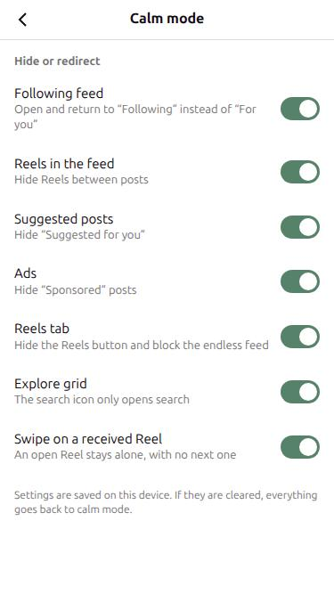

# calmgram

Instagram, without the endless scrolling. It's a lightweight Android app that opens the Instagram website and hides the parts built to keep you hooked:

- Opens on the feed of accounts you follow, not "For you"
- Hides Reels, suggested posts and ads
- Removes the Reels tab, and the search button opens search only, without the Explore grid
- A Reel someone sends you still opens, but you can't swipe to the next one
- Messages, photos and voice or video calls still work
- Each filter has its own switch under "Calm mode" in Instagram's settings

It doesn't patch or modify the official app. It shows the regular website with display rules on top. The app never reads or stores your login, and sends no data anywhere.



## What it does

Each behavior below has its own switch. All of them are on by default.

| Situation | Behavior |
|---|---|
| Opening the app | `/?variant=following` (feed of accounts you follow) |
| Home button (`/`) | Redirected to the following feed, without reloading |
| Reels in the feed | Collapsed to 1px. Infinite scroll keeps loading, and scroll anchoring is turned off so the page doesn't jump back. |
| "Suggested for you" posts | Collapsed to 1px |
| Ads ("Sponsored" label) | Collapsed to 1px, in both feeds |
| Reels button in the bottom bar | Hidden |
| `/reels/` and `/reels/audio/…` | Redirected to the feed |
| `/reels/ID` (swipeable feed) | Redirected to `/reel/ID` (single Reel, no swipe) |
| Explore `/explore/` | Redirected to `/explore/search/` (search only, no grid), without reloading |
| External links | Opened in your browser |
| Photos in messages | Android file picker |
| Calls | 📞 and 🎥 buttons at the top of a conversation open Instagram's call page (`/call/`) in the app. Outgoing calls only: the app doesn't ring when it's closed. |

## Settings

- **In Instagram:** Profile → ⚙ → Settings and privacy → **Calm mode**, below "Switch appearance". If Instagram removes that row, "Calm mode" appears at the top of the page instead.
- **Shortcut:** long-press the app icon → **Calm mode**.
- The panel is in English when Instagram is in English, and in French otherwise.
- Hiding or showing something applies right away. A redirect applies on the next tap.
- Settings are saved in the Instagram site's storage on the phone. If they're cleared, everything goes back to calm mode.
- On the phone, the app is named "Instagram" (package `fr.perso.calmgram`, with its own icon).
- Dark mode is Instagram's own: Settings → Switch appearance.

## What's inside

- `app/src/main/assets/calmfeed.js`: all the page rules. This is the file to fix when Instagram changes.
- `app/src/main/java/fr/perso/calmgram/MainActivity.kt`: the WebView.
- Permissions: Internet, plus microphone and camera for calls. Android asks for them on the first call, and the app only grants them to the page on `https://www.instagram.com/call/`, never anywhere else.
- The call buttons read the conversation's call ID from the page's internal data. If Instagram changes that data, a tap shows "Call unavailable" and the rest of the app keeps working.

**Your login:** the login page is Instagram's own. There is no bridge between the page and the app (`addJavascriptInterface` isn't used), so the app can't read what you type. `calmfeed.js` only reads the page address, the text of feed posts and its own settings. On the settings page, it adds the Calm mode row without reading anything. The WebView keeps the session cookie in the app's private data, never your password.

## Build and install

Requirements: Java 17 and the Android SDK (see below).

With the phone plugged in and USB debugging allowed:

```bash
./install.sh
```

This builds the app, waits for the phone, installs the app and opens it. To open the Calm mode panel directly:

```bash
./install.sh settings
```

After a build, Gradle stays in memory in the background. On a computer with little RAM, stop it:

```bash
./gradlew --stop
```

## Debug on the phone

With the debug APK installed and the phone plugged in, open `chrome://inspect` in Chrome or Chromium on the computer. You get the console and inspector for the Instagram page inside the app.

## Install the tools (once)

1. Java 17:

   ```bash
   sudo apt install openjdk-17-jdk-headless
   ```

2. The Android SDK, installed from the command line in `~/Android/Sdk` (Android Studio isn't needed). Accept Google's licenses with `sdkmanager --licenses`.
3. A `local.properties` file at the root of the project:

   ```
   sdk.dir=/home/<you>/Android/Sdk
   ```

## Credits

No code was copied. These projects served as inspiration or as examples of what to avoid:

- [DM Only](https://github.com/safwanpp/dm-only): loading the script at the very start of the page, removing `; wv` from the user agent, handling file uploads, following address changes, blocking the swipe on an open Reel.
- [NoReel](https://github.com/Kalbra/NoReel): sending the search button to the search-only page (`/explore/search/`).
- [ReelBlocker](https://github.com/QuosaiAlqreini/ReelBlocker): also removing `Version/x.y` from the user agent.
- The hiding rules come from personal uBlock Origin filters, translated into CSS and JS.

See also [calmbook](https://github.com/eloi-del/calmbook), the same idea for Facebook.

## Disclaimer

Personal project, not affiliated with Meta, which has neither approved nor reviewed it. Instagram and Facebook are trademarks of Meta. The app shows the official website and only adds display rules on top. It doesn't modify the official app, doesn't read your login and doesn't send anything anywhere. Use it at your own risk and in line with Meta's terms of use.

## License

MIT: see [LICENSE](LICENSE).
